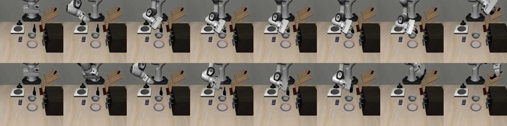
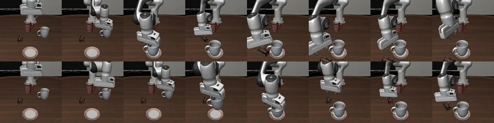
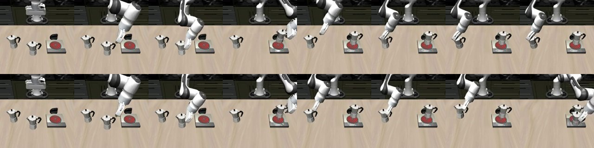
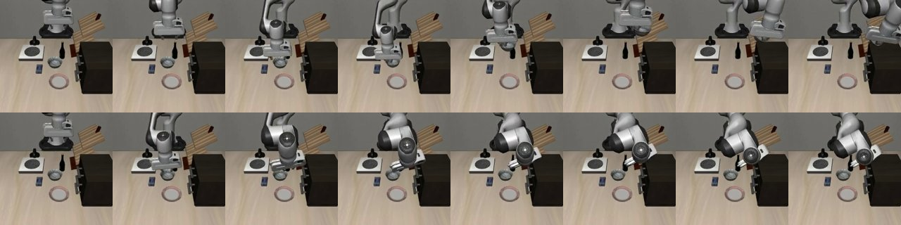

# 발표 자료 추가 가이드: OLIVE 가 잘 되는 곳 / 잘 안 되는 곳

2026-10-29 전체 run(`exp/full-run-20261029`) 결과를 바탕으로, 기존 발표 덱(9장, `slides/project/`)에
"baseline 이 어디서 실패하고 OLIVE 가 무엇을 고쳤는지, 그리고 반대로 무엇이 나빠졌는지"를 넣는 방법을 정리했다.

- 수치: 발표에는 **논문 수치**를 쓴다 (아래 1절).
- 정성 분석과 영상: **이번 run 의 task 단위 결과와 영상**을 쓴다 (2–3절).
- 두 출처를 섞지 말고 슬라이드에 출처를 각각 표기한다 (4절 "주의").

---

## 1. 발표에 쓸 수치 (논문)

| suite | Frozen OpenVLA | OLIVE | Δ |
|---|---|---|---|
| Spatial | 60.0 | 91.9 | **+31.9** |
| Object | 88.0 | 38.5 | **−49.5** |
| Goal | 70.0 | 71.4 | +1.4 |
| Long (LIBERO-10) | 40.0 | 50.0 | +10.0 |

참고로 이번 run(5,000 step)에서는 baseline 85.0 / 87.0 / 77.5 / 53.5,
OLIVE 82.0 / 88.0 / 73.0 / 58.0 으로 네 suite 모두 baseline 과 노이즈 범위(±7–10pp) 안이었다.
**Spatial +32 와 Object −50 은 이번 run 에서 재현되지 않았다.** 발표에서 이 점을 질문받을 수 있으니 4절 Q&A 참고.

---

## 2. 잘 되는 것: baseline 이 "목표 앞에서 머뭇거리다" 시간초과로 실패하는 경우

### 관찰 (이번 run, baseline 20 ep/task vs OLIVE 10 ep/task)

| task | baseline → OLIVE | baseline 실패 양상 (영상) | OLIVE |
|---|---|---|---|
| Long t00 수프+토마토소스 바구니 | 65 → 100 | 두 번째 물체에서 실패 | 10/10 성공 |
| Long t06 머그를 접시에, 푸딩을 오른쪽에 | 35 → 60 | 머그는 성공, 푸딩을 집었다 놓았다 반복 → 520 step 시간초과 | 286 step 완료 |
| Long t03 그릇을 서랍에 넣고 닫기 | 40 → 60 | 단계 전환에서 실패 | 평균 상승 (대표 영상 1 ep 은 서랍 못 닫음) |
| Goal t09 와인병을 랙에 | 45 → 70 | 병은 집었지만 랙 앞에서 위치 수정 반복 → 300 step 시간초과 | 144 step 에 바로 꽂음 |
| Long t08 모카포트 두 개 | 25 → 20 | 하나 올리고 두 번째에서 반복 → 시간초과 | 영상 ep 은 둘 다 성공(494 step), 평균은 낮음 |

### 해석
1. baseline 실패의 대부분은 엉뚱한 행동이 아니라 **목표 바로 앞에서 정밀 정렬을 못 해 반복하다 시간이 끝나는 것**.
2. OLIVE 는 frozen OpenVLA 의 hidden state 에 작은 보정 Δh = z·B 를 더하는 구조라,
   새 행동을 만들기보다 **거의 맞은 행동을 조금 밀어주는** 데 맞다 → "거의 성공" 형태의 실패에 가장 잘 듣는다.
3. 다단계 task(Long)의 **후반 하위 작업**에서 개선이 많다. 실패가 몰려 있는 곳이라 성공/실패 보상 차이(학습 신호)가 가장 많이 생긴다.
   논문의 Long +10, Spatial +32 와 같은 방향.

### 대표 영상
| 사례 | baseline | OLIVE | 8프레임 비교 |
|---|---|---|---|
| 와인병 → 랙 | `media/libero_goal_t09_baseline.mp4` (실패, 300 step) | `media/libero_goal_t09_olive.mp4` (성공, 144 step) |  |
| 머그+푸딩 | `media/libero_10_t06_baseline.mp4` (실패, 520 step) | `media/libero_10_t06_olive.mp4` (성공, 286 step) |  |
| 모카포트 두 개 | `media/libero_10_t08_baseline.mp4` (실패, 520 step) | `media/libero_10_t08_olive.mp4` (성공, 494 step) |  |

8프레임 이미지는 윗줄 baseline, 아랫줄 OLIVE, 왼쪽→오른쪽 시간순.

---

## 3. 잘 안 되는 것: baseline 이 이미 잘하던 task

### 관찰

| task | baseline → OLIVE | 영상 |
|---|---|---|
| Goal t04 그릇을 캐비닛 위에 | **100 → 70** | baseline 101 step 성공. OLIVE 는 그릇을 집고 캐비닛까지 가지만 정확히 못 내려놓고 300 step 시간초과 |
| Object t00 알파벳 수프 | 95 → 70 | 대표 영상이 둘 다 성공 (실패 장면 없음) |
| Long t05 책을 캐디 뒷칸에 | 95 → 80 | 〃 |
| Spatial t07 스토브 위 그릇 | 75 → 60 | 〃 |
| Goal t05 접시 밀기 | 75 → 60 | 둘 다 시간초과, 차이는 영상으로 구분 안 됨 |

baseline 성공률 구간별 평균 변화 (40 task):

| baseline 성공률 | task 수 | OLIVE 평균 변화 | 오름 / 내림 |
|---|---|---|---|
| ≤ 60% | 10 | +3.0pp | 3 / 5 |
| 65–85% | 12 | +2.5pp | 5 / 4 |
| **≥ 90%** | 18 | **−4.4pp** | 6 / 9 |

### 해석 (가설)
1. 보정 head 하나를 suite 의 10개 task 가 공유한다. 이미 100% 성공하는 task 는 보상 차이가 없어 **그 task 를 위한 학습 신호가 거의 0**.
2. head 는 실패가 많은 다른 task 를 고치는 쪽으로만 움직이고, 그 변화가 잘 되던 task 에 **간섭**으로 들어가 정밀 배치를 망친다 (Goal t04).
3. 논문의 Object 급락(88 → 38.5)도 baseline 이 원래 높은 suite 에서 가장 크게 떨어진 것이라 같은 원리일 가능성이 있다.
   단 이번 run 의 Object 는 88 로 유지돼 **우리 데이터로는 확인되지 않음**.
4. 추가 요인: actor gradient norm 이 84–330 인데 매 스텝 1.0 으로 클리핑 → 업데이트 방향이 거칠게만 반영돼 task 간 미세 조정이 어렵다.

### 대표 영상
| 사례 | baseline | OLIVE | 8프레임 비교 |
|---|---|---|---|
| 그릇 → 캐비닛 위 | `media/libero_goal_t04_baseline.mp4` (성공, 101 step) | `media/libero_goal_t04_olive.mp4` (실패, 300 step) |  |

---

## 4. 덱에 넣는 방법 (기존 9장 기준)

현재 순서: cover → method → setup → result → paper → tasks → stability → examples → takeaways

수정 후 순서 (11장):

| # | 슬라이드 | 작업 |
|---|---|---|
| 1 | cover | 그대로 |
| 2 | method | 그대로. 말할 때 "Δh 는 작은 보정" 이라는 점을 강조 (5·6번 슬라이드의 복선) |
| 3 | setup | 그대로 |
| 4 | **result** | 막대 수치를 **1절 논문 수치**로 교체. 출처 "논문 Table 1" 표기 |
| 5 | **NEW: 잘 되는 것** | 2절. 아래 레이아웃 A |
| 6 | **NEW: 잘 안 되는 것** | 3절. 아래 레이아웃 B |
| 7 | **NEW: 왜 그런가** | 2·3절 해석을 한 장에. 아래 레이아웃 C |
| 8 | stability | 그대로 (actor grad 클리핑 = 3절 해석 4번의 근거) |
| 9 | paper | 이름을 "재현 결과" 로 바꾸고 이번 run 수치(1절 참고 문단)를 여기로. "5,000 step 에서는 재현 안 됨" 을 명시 |
| 10 | tasks | 부록으로 이동하거나 삭제 (5·6번이 대체) |
| 11 | takeaways | 아래 문구로 교체 |

`examples` 슬라이드는 5·6번에 흡수되므로 삭제.

### 레이아웃 A: "잘 되는 것: 목표 앞에서 머뭇거리던 실패를 고친다"
- 왼쪽 60%: 와인병 영상 쌍 (baseline 실패 | OLIVE 성공), 각 아래에 "300 step 시간초과" / "144 step 성공"
- 오른쪽 40%: 불릿 3개
  - baseline 실패의 대부분은 목표 바로 앞의 정렬 반복
  - OLIVE 는 거의 맞은 행동을 조금 밀어줌
  - 다단계 task 의 후반 하위 작업에서 효과가 큼 (Long +10)
- 하단 캡션: "머그+푸딩 35→60%, 와인병 45→70% (이번 run, task 단위)"

### 레이아웃 B: "잘 안 되는 것: 이미 잘하던 task 가 흔들린다"
- 왼쪽: 그릇→캐비닛 영상 쌍 (baseline 성공 101 step | OLIVE 실패 300 step)
- 오른쪽: 3절의 성공률 구간 표 (≥90% 행 강조)
- 하단 캡션: "논문 Object 88 → 38.5 와 같은 방향의 현상으로 추정"

### 레이아웃 C: "왜 그런가"
두 칸 비교:

| | 잘 되는 곳 | 잘 안 되는 곳 |
|---|---|---|
| baseline 상태 | 거의 성공, 마지막 정렬에서 실패 | 이미 90% 이상 |
| 학습 신호 | 성공/실패가 섞여 많음 | 거의 0 |
| head 의 영향 | 해당 task 를 직접 개선 | 다른 task 를 위한 변화가 간섭 |
| 대표 | Long, Spatial(논문) | Object(논문), Goal t04 |

### takeaways 교체 문구
- 잘 되는 것: baseline 이 목표 앞에서 머뭇거리는 실패, 다단계 task 후반부
- 잘 안 되는 것: baseline 이 이미 잘하는 task, head 공유로 인한 task 간 간섭
- 다음: task 조건부 head 또는 성공 task 에 대한 KL 규제 / actor gradient 스케일 수정 / 50,000 step

### 발표 멘트 예시
> "OLIVE 는 OpenVLA 를 고치는 게 아니라 마지막 한 끗을 밀어주는 방식입니다. 그래서 baseline 이 목표 바로 앞에서 머뭇거리다 실패하는 경우엔 잘 듣고, 이미 잘하던 task 에선 오히려 다른 task 를 위한 보정이 섞여 들어가 흔들립니다. 논문에서 Spatial 이 크게 오르고 Object 가 크게 떨어진 것도 이 두 현상으로 설명할 수 있다고 봅니다."

---

## 5. 주의와 예상 질문

- **출처 구분**: 수치 슬라이드는 "논문", 영상·task 분석 슬라이드는 "자체 재현 run (5,000 step)" 으로 표기.
- **표본 크기**: task 당 OLIVE 10 ep, baseline 20 ep → task 하나의 ±10–20pp 는 노이즈 수준. 개별 task 를 단정적으로 말하지 말고 경향으로 말할 것.
- **대표 영상 선택 편향**: 영상은 task 당 1 ep 이고, 수집 시 성공 ep 을 우선했다. 개선 사례 영상은 "그 task 의 평균" 이 아니다 (예: 모카포트는 영상은 성공이지만 평균 25 → 20%).

예상 질문:
- Q. 재현했는데 왜 논문만큼 안 나왔나?
  A. 5,000 step(논문 50,000)으로 짧게 돌렸고, actor gradient 가 매 스텝 클리핑돼 정책이 baseline 근처에 머물렀다. baseline 자체도 우리 환경에서 논문보다 높다 (평가 설정 차이 확인 중).
- Q. Object 하락이 재현 안 됐는데 3절 해석을 믿을 수 있나?
  A. suite 단위로는 재현 안 됐고, task 단위 경향(≥90% task 평균 −4.4pp)만 같은 방향이다. 가설로 제시.

---

## 6. 파일 위치

- 영상 80개: `media/{suite}_t{NN}_{baseline,olive}.mp4` (+ 마지막 프레임 `.jpg`)
- 8프레임 비교 40장: `analysis/sheets/{suite}_t{NN}.jpg` (생성: `analysis/make_sheet.py`)
- task 별 수치: `results.json` → `suites[].tasks[]`
- 상세 결과 페이지: `index.html` (같은 폴더의 `results.json` 을 읽음)
- 기존 덱 소스: `slides/project/`
- 원본 run 전체 (체크포인트, 전체 eval 영상, 로그): 레포 루트 `result/`
